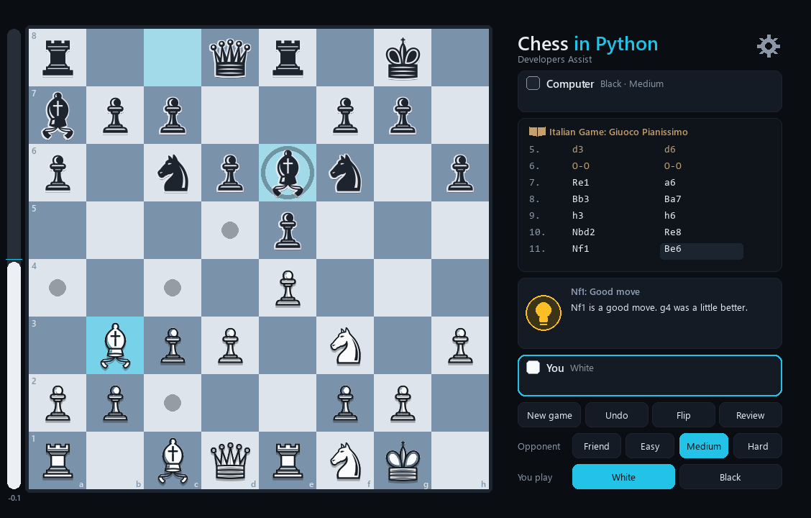
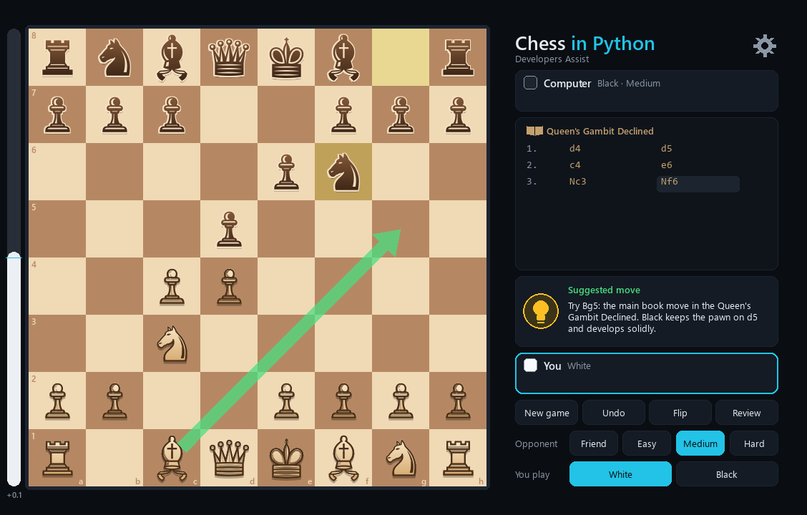
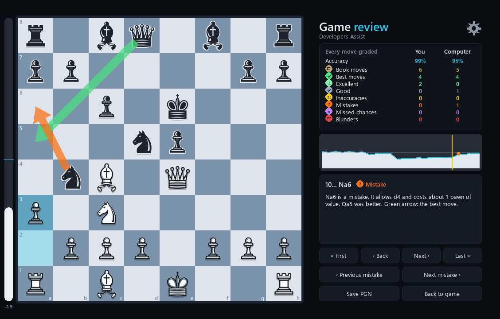
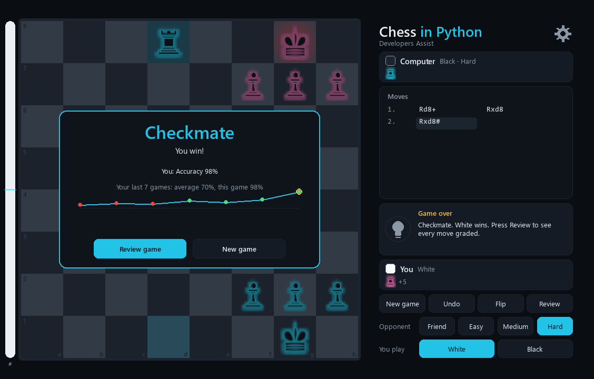
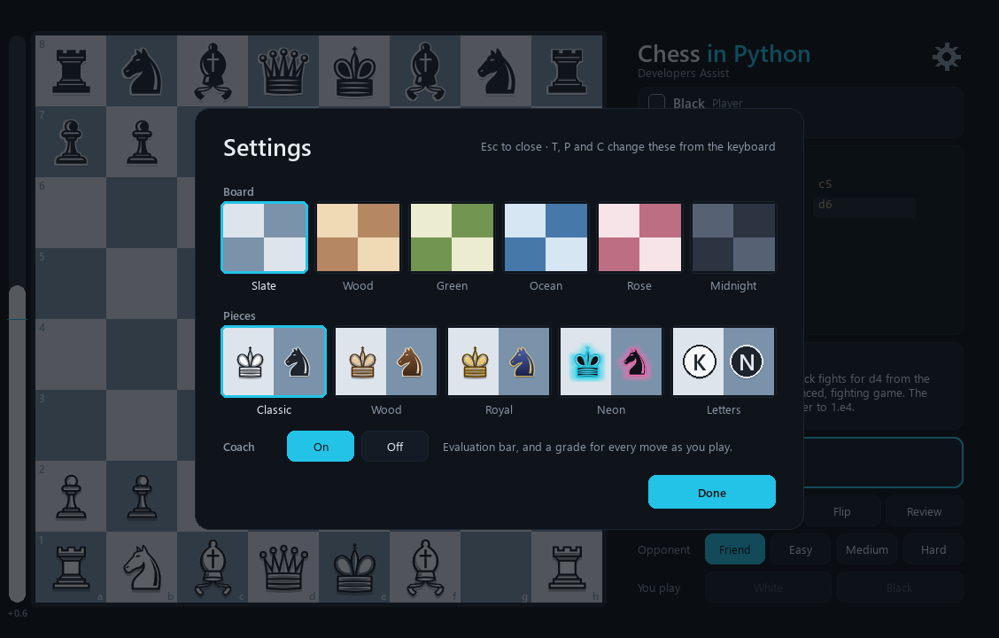

# Chess in Python: our own engine, a chess coach and real openings

[](https://github.com/DeveloperAssist/chess/actions/workflows/ci.yml)


Play chess against the computer (Easy, Medium or Hard) or a friend on the same screen, with a
**coach** that grades every move and tells you what to play next. **Every rule is our own Python
code: no chess library.** It's free and offline, and it needs one package (`pygame-ce`, for the window).

- **The rules engine** knows every rule: castling, en passant, promotion, check, checkmate,
  stalemate and the three draws (threefold repetition, the 50-move rule, not enough material). It
  is **proven correct with perft**: it matches the published counts up to 4,865,609 positions.
- **The computer player** uses minimax with alpha-beta pruning, quiescence search and iterative
  deepening, the same ideas as real chess engines. It opens with **real openings** from a
  book of 77 named positions and 59 master lines.
- **The coach:**
  - An evaluation bar shows who's winning after every move.
  - Every move gets a grade: book, best, excellent, good, inaccuracy, mistake, missed chance or blunder.
  - A **lightbulb** answers "What should I play?" and explains why.
- **The game review:** when the game ends, you get:
  - your accuracy;
  - your blunders, mistakes and missed chances, each explained, with arrows for what you played and what was best;
  - an advantage curve;
  - your **learning curve** across your recent games.
- **Themes:** 6 boards and 5 piece sets (Classic, Wood, Royal, Neon and Letters).

A free Python project by [Developers Assist](https://www.youtube.com/@developersAssist).



**Contents:** [Features](#features) · [What you'll learn](#the-python-and-dsa-youll-learn-from-it) ·
[Get it running](#get-it-running-step-by-step) · [Controls](#controls) ·
[How it works](#how-it-works) · [Read the code](#read-the-code-in-this-order) · [Tests](#tests) ·
[Troubleshooting](#troubleshooting) · [Ideas for your resume](#add-features-of-your-own)

---

## Features

### The coach, while you play

- **Evaluation bar** (left of the board). The white part grows when White is better. The number
  under it is the score in pawns: `+1.2` means White is about a pawn and a bit ahead, and `M3`
  means mate in 3.
- **A grade for every move.** It's shown in the move list (`Qh5?!`, `Nf6??`) and explained in the
  coach card ("Nf6 is a blunder. It allows mate in 1, starting with Qxf7#. g6 was better.").
- **The lightbulb: "What should I play?"** It draws a green arrow and says why ("Try Bg5: the main
  book move in the Queen's Gambit Declined. Black keeps the pawn on d5 and develops solidly.").
- **When the computer slips,** the coach tells you there's a strong reply and lets you find it.



### The review, when the game ends

The game-over card shows your accuracy and how many blunders, mistakes and missed chances you made.
Against the computer, it also shows your **learning curve**: your accuracy over your last 10 games.
Press **Review game** to go through it move by move:

- **A summary table:** accuracy, then how many moves of each kind, for both players.
- **The advantage curve:** who was better after every move. Coloured dots mark the mistakes; click
  anywhere on it to jump there.
- **Every move explained,** with two arrows: what was played (in the move's colour) and the best
  move (green). **Next mistake** jumps straight to the moves worth learning from.



| Grade | What it means |
|---|---|
| Book move | A known opening move (from the opening book). |
| Best move | The move the coach would play. |
| Excellent / Good | Almost as good as the best move. |
| Inaccuracy `?!` | A small slip: it gives away a little of your chances. |
| Mistake `?` | A real error: a clear part of your advantage is gone. |
| Missed chance | You had a winning move (often a capture or a mate) and played something else. |
| Blunder `??` | A move that throws the game away, like hanging your queen or allowing mate. |



### Real openings

The computer plays real openings, picked at random but weighted towards the popular ones. These
include the Italian Game, Ruy Lopez, Scotch, Sicilian (Najdorf, Dragon, Sveshnikov and more),
French, Caro-Kann, Queen's Gambit, Slav, London System, King's Indian, Nimzo-Indian, Grünfeld,
Dutch, English, Réti and more. The name of your opening is shown above the moves, and the coach
explains the idea behind it. Change move order and it still knows where you are (transpositions
count).

### Themes

Open **Settings** (the gear, or `G`) to choose:

- **Boards:** Slate, Wood, Green, Ocean, Rose or Midnight.
- **Pieces:** Classic, Wood, Royal (gold against navy), Neon (glowing cyan against pink) or
  Letters (K, Q, R, B, N, P in circles: handy while you learn notation).

Your choice is remembered. You can also turn the coach off there, if you'd like to play without help.



---

## The Python (and DSA) you'll learn from it

| Topic | Where it's used |
|---|---|
| **Lists and `divmod`** | The board is one list of 64 squares. `row, col = divmod(square, 8)` ([board.py](src/chessgame/board.py)). |
| **Lookup tables** | Where a knight on g1 can jump, or which squares a rook on a1 can slide to, is worked out once when the program starts, then just looked up. |
| **Stack** | `make()` pushes an undo record and `unmake()` pops it. The Undo button, the computer's search and the captured-pieces list all use it. |
| **Recursion** | `perft`, `negamax` and `quiescence` all call themselves, one move deeper each time. |
| **Trees and backtracking** | The computer's search is a game tree: make a move, look deeper, take it back, try the next. |
| **Minimax and alpha-beta pruning** | The computer player ([ai.py](src/chessgame/ai.py)). Alpha-beta gives the same answer as minimax while looking at far fewer positions. |
| **Hashing and dictionaries** | The opening book and the analysis cache look positions up by a key, so transpositions and repeated positions are found instantly. |
| **Weighted random choice** | `random.choices(..., weights=...)` picks the computer's opening, so popular lines come up more often. |
| **A little maths** | Scores in centipawns become an expected result with the logistic function `1 / (1 + e^(-k·x))`, the way Lichess grades moves. |
| **Sorting with `key=`** | Move ordering: captures first, biggest victim with the smallest attacker ("MVV-LVA"). |
| **Dataclasses and `NamedTuple`** | `Move`, `Undo`, `Outcome`, `MoveReview`, `Settings`, `GameRecord`: small classes with no boilerplate. |
| **`match`/`case`** | Generating moves for each kind of piece; explaining each grade; the terminal mode's commands. |
| **Threads, `queue`, `threading.Event` and `Lock`** | Two background threads: the computer thinks in one, the coach analyses in another. The coach pauses while the computer thinks, and Undo or New game stops the search at once. |
| **Files and JSON** | Your settings and your game history (the learning curve) are small JSON files in your home folder. |
| **Text formats** | FEN (a position in one line), SAN (`Nf3`, `exd5`, `O-O`, `e8=Q+`) and PGN (a whole game). |
| **pygame-ce** | Drawing, events, see-through layers, gradients, a glow effect, animation, charts. |
| **Packaging and CLI** | `uv`, an entry point and `argparse` sub-commands: `chess`, `chess terminal`, `chess perft`. |
| **Testing** | 365 pytest tests. They include perft, every opening line, the grading rules and window tests that run with no screen. |

---

## Get it running (step by step)

It runs on Windows, macOS and Linux. Any laptop is fine.

### Step 1: Install the tools (once)

1. **uv**, the Python project manager (it installs Python 3.14 for you):
   ```powershell
   # Windows (PowerShell)
   powershell -ExecutionPolicy ByPass -c "irm https://astral.sh/uv/install.ps1 | iex"
   ```
   ```bash
   # macOS / Linux
   curl -LsSf https://astral.sh/uv/install.sh | sh
   ```
2. **Git**, to get the code: [git-scm.com](https://git-scm.com).

### Step 2: Get the code

```bash
git clone https://github.com/DeveloperAssist/chess.git
cd chess
uv sync
```

### Step 3: Play

```bash
uv run chess
```

You play White against the computer on Medium, with the coach on. Change the opponent, the level
and your colour with the buttons on the right at any time.

### Other ways to run it

| Command | What it does |
|---|---|
| `uv run chess --friend` | Two players on one screen. |
| `uv run chess --black --level hard` | You play Black against Hard. |
| `uv run chess --fen "8/8/8/4k3/8/8/8/3QK3 w - - 0 1"` | Start from any position (here: can *you* mate with king and queen?). |
| `uv run chess terminal` | Play in the terminal: type moves like `e4`, `Nf3`, `O-O`. Type `hint` for the coach, `review` for a review. Add `--ascii` for letters instead of symbols. |
| `uv run chess perft 5` | Count every possible game 5 moves deep (4,865,609) and time it. Add `--divide` to split the count by first move. |

---

## Controls

| Do this | And this happens |
|---|---|
| Click a piece, then a square | Moves it. Dots show where it can go; rings show captures. |
| Drag a piece | Also moves it. |
| Pawn to the last rank | Pick a queen, rook, bishop or knight. |
| **Lightbulb** or `H` | "What should I play?": a green arrow and the reason. |
| **Review** or `R` | Reviews the game so far (or click any move in the move list). |
| `←` `→` `Home` `End` | Step through the review. `↑` `↓` jump between mistakes. |
| **Undo** or `U` | Takes back your move (and the computer's reply). |
| **New game** or `N` | Starts again. |
| **Flip** or `F` | Turns the board round. |
| **Settings** (gear) or `G` | Board, pieces and coach. `T` and `P` switch board and pieces; `C` turns the coach on or off. |
| `S` | Saves the game to `games/` as PGN. Open it on [lichess.org/paste](https://lichess.org/paste) to analyse it. |
| `Esc` | Closes Settings or the review, or puts down the selected piece. |

---

## How it works

### 1. The board is a list of 64 squares

```
     a  b  c  d  e  f  g  h
  8  0  1  2  3  4  5  6  7          Each square holds one letter, like in FEN:
  7  8  9 10 11 12 13 14 15          K Q R B N P are White, k q r b n p are Black,
  ...                                and "." is an empty square.
  1 56 57 58 59 60 61 62 63          row, col = divmod(square, 8)
```

Next to the squares, a `Board` remembers whose turn it is, the castling rights, the en passant
square and the move counters. That is everything in a **FEN**, so a whole position fits in one line:
`rnbqkbnr/pppppppp/8/8/4P3/8/PPPP1PPP/RNBQKBNR b KQkq e3 0 1`.

### 2. Legal moves in two steps

1. **Pseudo-legal moves** follow how each piece moves. Knights and kings take one step from a
   lookup table. Bishops, rooks and queens slide along rays until they hit something. Pawns push,
   double-push, capture diagonally, take en passant and promote. Castling checks that the squares
   between are empty and that the king doesn't pass through check.
2. **Legal moves:** play each move, see if our own king is now attacked, and take it back.

### 3. Proving it right: perft

`perft(depth)` counts every possible sequence of moves. These counts are known exactly, and one
wrong rule changes them. Our engine matches every count we tried, on six famous test positions:

| Position | Depth 1 | 2 | 3 | 4 | 5 |
|---|---|---|---|---|---|
| Start | 20 | 400 | 8,902 | 197,281 | 4,865,609 |
| "Kiwipete" (castling, pins, en passant) | 48 | 2,039 | 97,862 | 4,085,603 | |
| Position 3 (en passant tricks) | 14 | 191 | 2,812 | 43,238 | 674,624 |
| Position 4 (promotions) | 6 | 264 | 9,467 | 422,333 | |
| Position 5 | 44 | 1,486 | 62,379 | 2,103,487 | |
| Position 6 | 46 | 2,079 | 89,890 | | |

(Counts from the [Chess Programming Wiki](https://www.chessprogramming.org/Perft_Results).)

### 4. The computer player

1. **Opening book first:** while the position is in the book, it plays a book move.
2. **Evaluate** a position as a number, in centipawns (100 = one pawn): material plus small bonuses
   for good squares. Two bishops earn a bonus. **Mop-up:** a rook or more ahead in the endgame, it
   pushes the enemy king to the edge, so it can mate with king and queen.
3. **Negamax** (minimax written the short way), **alpha-beta pruning**, **quiescence search**
   (keep following captures at the end) and **iterative deepening** (1 half-move ahead, then 2,
   then 3, until time runs out).
4. **Repetition:** a return to a position from the game counts as a draw, so a winning computer
   makes progress and a losing one looks for a repetition.

| Level | Looks ahead | Time per move | Character |
|---|---|---|---|
| Easy | 1 half-move | instant | Sees what it can take, but not your reply. Some randomness. |
| Medium | 2 half-moves + captures | 2 s at most | Doesn't hang pieces. A good opponent for beginners. |
| Hard | up to 5 half-moves + captures | up to 3 s | Finds short mates, wins won endgames. |

### 5. The coach

1. **Analyse** each position 3 half-moves deep: the best move and its score ([analysis.py](src/chessgame/analysis.py)).
2. **Score the move you played** by analysing the position after it from your opponent's side,
   one half-move shallower, so both scores look equally far ahead.
3. **Turn scores into an expected result** between 0 (lost) and 1 (won), like Lichess:
   `1 / (1 + e^(-0.00368 × centipawns))`. Being +9 or +12 both count as "winning", so a grade
   depends on how much of your *chances* a move threw away, not just pawns.
4. **Grade** it: losing under 0.02 of a point is best or excellent. 0.05 is an inaccuracy, 0.10 a
   mistake and 0.20 a blunder. Throwing away most of a winning position (but not losing) is a
   missed chance. **Accuracy** uses Lichess's formula for each move, averaged.
5. **Explain** it in plain words ([coach.py](src/chessgame/coach.py)), with simple rules:
   is it a capture, a check, castling, a developing move, a centre pawn, an escape? For bad moves:
   what's the opponent's best answer, and what does it win?

The coach is as strong as the Hard level. It catches hanging pieces, missed mates and simple
tactics well, but a grandmaster-level engine would disagree with some of its finer grades.

### 6. The window

One loop, 60 times a second: **handle events** → **update** (pick up the computer's move and the
coach's grades from the background threads) → **draw**. The analyst works on the most urgent
position first (the one on the board), then your last move, then the rest of the game. That way
the review at the end is usually ready the moment the game ends.

---

## Read the code in this order

1. [board.py](src/chessgame/board.py): the board, FEN, `make`/`unmake`, move generation, check.
2. [perft.py](src/chessgame/perft.py): about 30 lines that prove `board.py` is right.
3. [notation.py](src/chessgame/notation.py): SAN (`Nbd7`, `exd6`, `O-O`), reading typed moves, PGN.
4. [game.py](src/chessgame/game.py): a game: moves played, repetition counts, how it ended.
5. [openings.py](src/chessgame/openings.py): the opening book: names, ideas and master lines.
6. [ai.py](src/chessgame/ai.py): the computer player.
7. [analysis.py](src/chessgame/analysis.py) and [coach.py](src/chessgame/coach.py): grading moves and explaining them.
8. [themes.py](src/chessgame/themes.py), [progress.py](src/chessgame/progress.py) and [ui.py](src/chessgame/ui.py): the looks, your history and the window.
9. [terminal.py](src/chessgame/terminal.py) and [cli.py](src/chessgame/cli.py): the terminal mode and the `chess` command.

---

## Tests

```bash
uv run pytest            # 360 tests in about 30 seconds (no screen needed)
uv run pytest -m slow    # 5 deeper perft counts
uv run ruff check src tests
```

The window tests click pieces, open Settings and step through reviews with fake mouse and keyboard
events while SDL draws into memory. That's how GitHub Actions runs them on Ubuntu and Windows.

---

## Troubleshooting

| Problem | Fix |
|---|---|
| Pieces show as letters in circles | Your computer has no font with chess symbols. On Linux: `sudo apt install fonts-dejavu-core`. Windows and macOS have one built in. |
| `No available video device` | You're on a machine with no screen (a server, WSL without a desktop). Use `uv run chess terminal`. |
| `uv` is not recognised | Close and reopen the terminal after installing uv. |
| The computer takes a few seconds | That's Hard thinking (up to 3 s). Medium takes 2 s at most. |
| The review says "Analysing…" | The coach is still grading the last few moves; it fills in by itself within seconds. |
| Start fresh | Delete `.chess-in-python.json` (settings) and `.chess-in-python-history.json` (your learning curve) from your home folder. |

---

## Add features of your own

Ideas that make this project yours (and a stronger resume line):

1. **Sounds** for moves, captures and check (`pygame.mixer`).
2. **A chess clock**: 5 minutes each plus 3 seconds a move.
3. **Opening trainer**: pick an opening, and the computer quizzes you on its book moves.
4. **Puzzles from your own games**: turn each blunder in your history into a "find the best move" puzzle.
5. **A transposition table** with Zobrist hashing: remember positions already searched, and
   search deeper in the same time.
6. **Load a PGN** and review any game, even one from Lichess.
7. **Play online with a friend** using FastAPI and WebSockets.

---

## Licence

MIT: see [LICENSE](LICENSE). The window uses [pygame-ce](https://pyga.me) (LGPL), installed as a
normal, unchanged package. The rules engine, computer player, coach and opening book are our own
code. The pieces are drawn from the chess symbols in your system's fonts, so no image files are needed.
